# How to Use GitHub's Reverse-Engineering Topic Page (and Solve Your First Crackme in Ghidra)

*A no-hype, beginner-friendly field guide, with receipts.*

**By Richard ([@P7RIM3](https://x.com/P7RIM3)) · October 12, 2026**

> **About the receipts.** I checked every link, version number, star count and license below on **October 12, 2026 (ET)**, using the GitHub web UI and the public GitHub REST API. Every image is a real screenshot taken in a browser or in a running copy of Ghidra 12.1.4. Nothing is mocked up. The one diagram is labeled **Diagram**. Star counts and "latest release" versions change daily, so treat the numbers as a snapshot and re-check them yourself. That re-checking is half the point of this guide.

---

## Table of contents

0. TL;DR
1. What reverse engineering is, and the rules you follow
2. Navigating `github.com/topics/reverse-engineering`, step by step
3. A curated list of real tools from that page (with receipts)
4. Hands-on: install Ghidra and solve your first crackme (Windows + Linux)
5. Next steps and learning resources
6. X-ready teaser post
7. Appendix A: crackme source code (spoilers)
8. Appendix B: sources checked

---

## 0. TL;DR

- **The page:** <https://github.com/topics/reverse-engineering> lists every public repo that tagged itself `reverse-engineering`. On Oct 12, 2026 that was **14,180 repositories**.
- **How to use it:** sort by **Most stars** to find the established tools. Sort by **Recently updated** to see what is active. Filter by **Language** to narrow it down. Then judge each repo before you download anything: README, license, recent commits, issues, releases, and an official download source.
- **Stars aren't proof.** On the day I checked, the #1 repo by stars was **6 months old** with more stars than Ghidra, which has been public since 2019. That may be fine. It still tells you nothing about safety. Check everything else.
- **Your first lab:** install **JDK 21+** and then **Ghidra 12.1.4**, using only the official GitHub release. Verify the SHA-256. Work in a VM. Compile the tiny practice crackme in Appendix A, import it, auto-analyze, find `main`, rename things, and recover the password from the decompiler output.

---

## 1. What reverse engineering is, and the rules you follow

### 1.1 Plain-English definition

**Software reverse engineering (RE)** means working backwards from a finished program to understand how it works, usually without the original source code.

Programmers write **source code**, for example in C. A **compiler** turns it into a **binary**, the `.exe` on Windows or the ELF file on Linux. A binary is just bytes of machine instructions, and your CPU runs it. Reverse engineering goes the other way:

- A **disassembler** turns the bytes back into readable **assembly** instructions (`MOV`, `CMP`, `JNZ` and so on).
- A **decompiler** goes one step further. It produces **C-like pseudocode** that is far easier to read than assembly.
- A **debugger** lets you run the program one step at a time and look at memory and registers while it runs.
- A **hex editor** shows you the raw bytes of a file.

GitHub's own description on the topic page puts it this way: *"The process of analyzing a subject system to identify the system's components and their interrelationships and to create representations of the system in another form or at a higher level of abstraction."* You'll see it at the top of the page (Figure 2).

People use RE to:

- **Analyze malware** and figure out what it does, how it spreads, and how to detect it
- **Hunt vulnerabilities** so they get fixed (responsible disclosure)
- Build **interoperability**, for example so a device you own works with Linux
- **Recover lost knowledge**, such as legacy software whose source is gone
- **Play security CTFs** and learn how computers really work

### 1.2 The rules (read this twice)

Reverse engineering is a skill. It is legal or illegal depending on **what** you analyze, **why**, and **where you live**. I'm not a lawyer and this is not legal advice. These are the practical rules I follow and recommend:

1. **Only analyze software you own or wrote, or that you have explicit permission to analyze.** "Permission" means a license that allows it, a written authorization, a bug-bounty scope that includes it, or a challenge built to be reversed.
2. **Start with targets designed for practice:**
   - **Crackmes** are small programs built to be reversed. [crackmes.one](https://crackmes.one/) hosts thousands. Its FAQ says: *"Crackmes are legal and ethical because they are made specifically for this purpose."*
   - **CTF challenges** (Capture The Flag), for example [picoCTF](https://picoctf.org/) or events listed on [CTFtime](https://ctftime.org/).
   - **Your own programs.** Compile something yourself and reverse it. That's what we do in Section 4.
3. **Read the EULA / license.** Many commercial licenses forbid reverse engineering. Some laws carve out exceptions, such as interoperability rules in the EU or the U.S. DMCA §1201 security-research exemptions, but those exceptions are narrow and specific. If you're unsure, don't. For background, the EFF keeps a [Coders' Rights reverse-engineering FAQ](https://www.eff.org/issues/coders/reverse-engineering-faq), and the U.S. Copyright Office posts the current [§1201 exemptions](https://www.copyright.gov/1201/).
4. **No cracking commercial software, no game cheats, no DRM circumvention.** Even crackmes.one bans these. Its FAQ prohibits *"Game cracking, cheating, or modding,"* *"Commercial software cracking or DRM circumvention,"* and real malware.
5. **Don't redistribute** other people's binaries or cracked material.
6. **Work in an isolated VM** whenever you run code you didn't write (Section 4.2).
7. **If you find a real vulnerability, disclose it responsibly** through the vendor's security policy or bug-bounty program.

Ghidra itself makes this point the first time you launch it. This is the actual user agreement dialog from Ghidra 12.1.4:

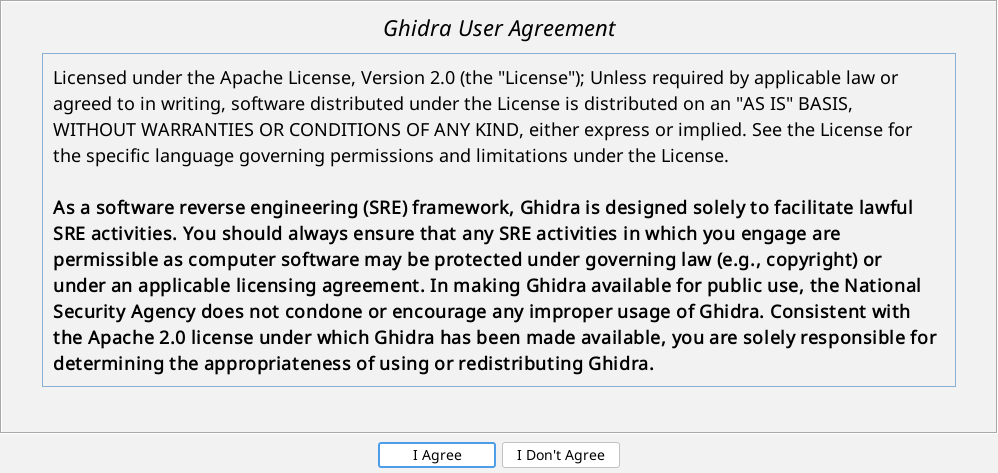

> *"As a software reverse engineering (SRE) framework, Ghidra is designed solely to facilitate lawful SRE activities. You should always ensure that any SRE activities in which you engage are permissible as computer software may be protected under governing law (e.g., copyright) or under an applicable licensing agreement."* (Ghidra User Agreement, v12.1.4)

---

## 2. Navigating `github.com/topics/reverse-engineering`, step by step

### 2.1 What a GitHub "topic" is

Repo owners can tag their repository with **topics**, such as `reverse-engineering`, `disassembler` or `ctf`. Each topic gets a public page that lists every repo with that tag. Two caveats:

- **Owners tag themselves.** Nobody curates this list. Inclusion is not an endorsement.
- **Some great tools don't use the tag.** On Oct 12, 2026, **JADX** (`skylot/jadx`, ~50.9k stars) and **Frida** (`frida/frida`, ~22.2k stars) were **not** tagged `reverse-engineering`, so they don't appear on the page. I include them in Section 3 anyway and flag them.

### 2.2 Step 1: open the page

Go to **<https://github.com/topics/reverse-engineering>**. You don't need a GitHub account to browse.

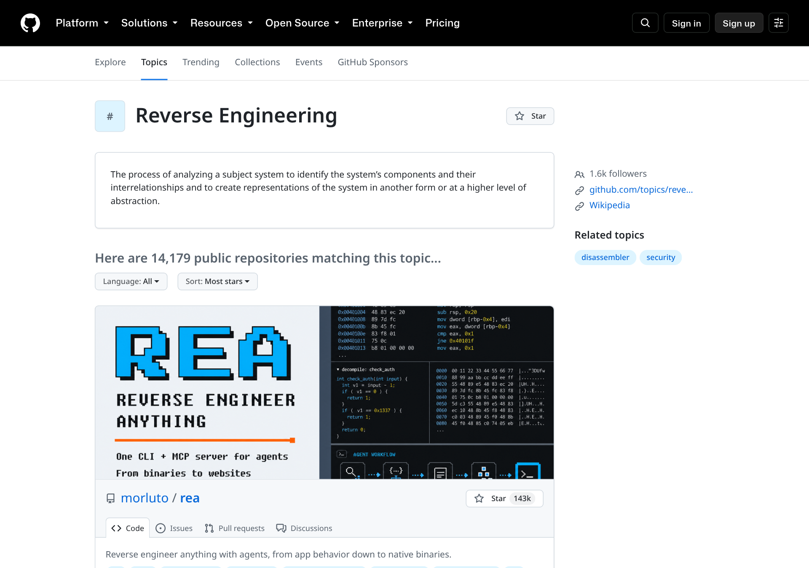

What you see, top to bottom:

1. **Topic title and description**, plus follower count (~1.6k followers) and links in the right sidebar
2. **Related topics** (here: `disassembler`, `security`). Click them to branch out.
3. **"Here are N public repositories matching this topic..."** (14,180 when I checked)
4. Two buttons: **Language: All** and **Sort: Most stars**
5. A list of **repository cards**, 20 per page, with a **Load more...** button at the bottom

### 2.3 Step 2: sort the list

Click **Sort**. You get six options, and each one is just a URL parameter:

| Sort option | URL | Use it to... |
|---|---|---|
| Most stars | `?o=desc&s=stars` | find established, widely used tools |
| Fewest stars | `?o=asc&s=stars` | dig for brand-new or niche projects |
| Most forks | `?o=desc&s=forks` | find projects people build on |
| Fewest forks | `?o=asc&s=forks` | (rarely useful) |
| Recently updated | `?o=desc&s=updated` | see what's active *right now* |
| Least recently updated | `?o=asc&s=updated` | find abandoned or archival repos |

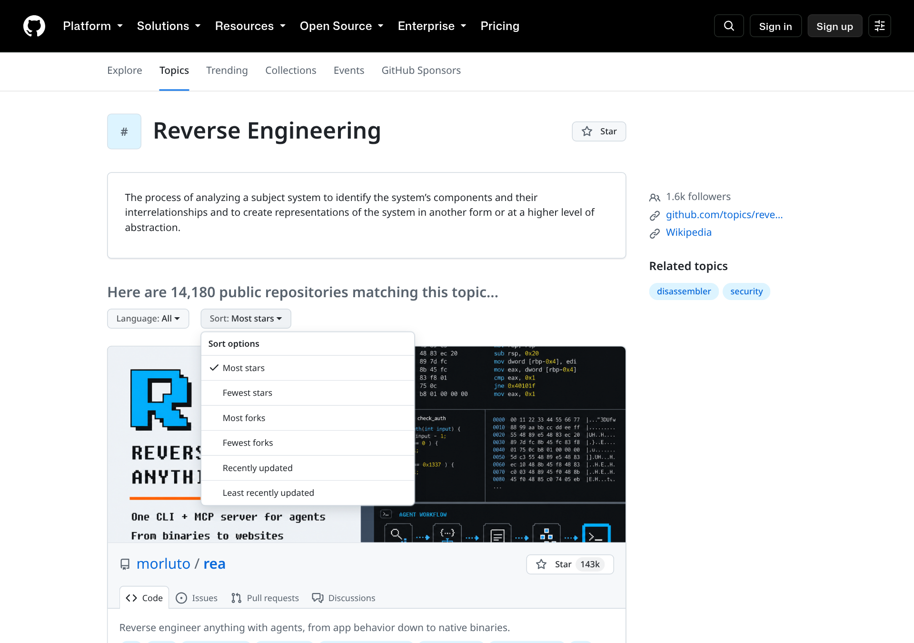

**Tip:** bookmark the sorted URL directly, for example
<https://github.com/topics/reverse-engineering?o=desc&s=stars>.

"Recently updated" is noisy. When I checked, the top results were game decompilation projects pushed minutes earlier (Figure 4). It's great for discovery and useless as a quality signal.

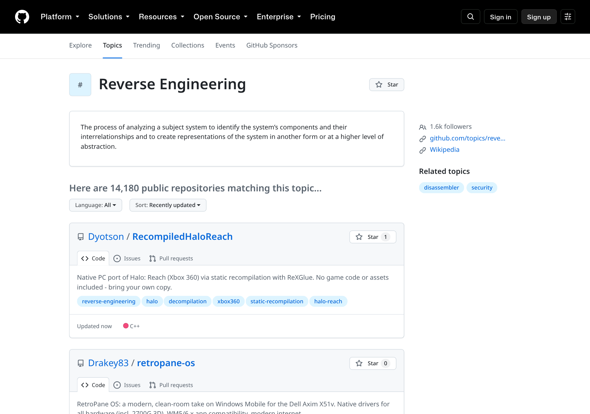

### 2.4 Step 3: filter by language

Click **Language: All** to filter by the repo's main programming language. The counts on Oct 12, 2026:

| Language | Repos |
|---|---|
| Python | 4,263 |
| C++ | 1,740 |
| C | 1,279 |
| JavaScript | 713 |
| C# | 709 |
| Rust | 651 |
| TypeScript | 498 |
| Java | 417 |
| HTML | 346 |
| Shell | 267 |

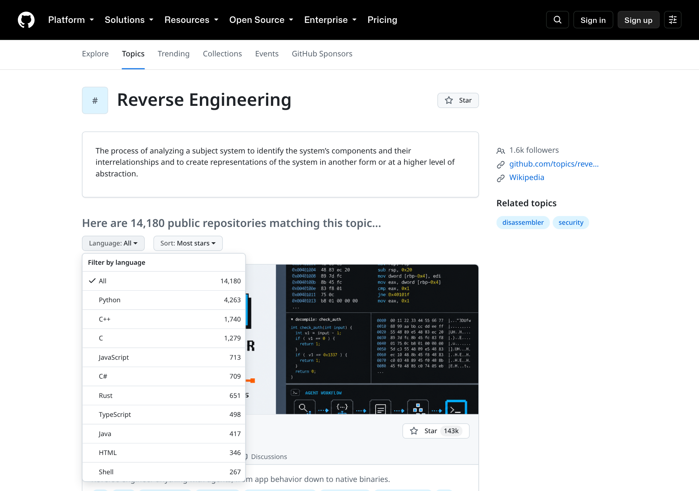

The language filter is the parameter `l=`, and it combines with sorting. For example, Python RE projects by stars:
<https://github.com/topics/reverse-engineering?l=python&o=desc&s=stars>

That view surfaces things like **OWASP MASTG**, **pwndbg** and **GEF** (GDB add-ons), and **LLM4Decompile** (Figure 6).

**Why filter by language?** Pick the language you can read. If something breaks or looks sketchy, you can open the source and understand it. It also tells you how you'll install it: Python usually means `pip`, C/C++ usually means prebuilt binaries or a compile step.

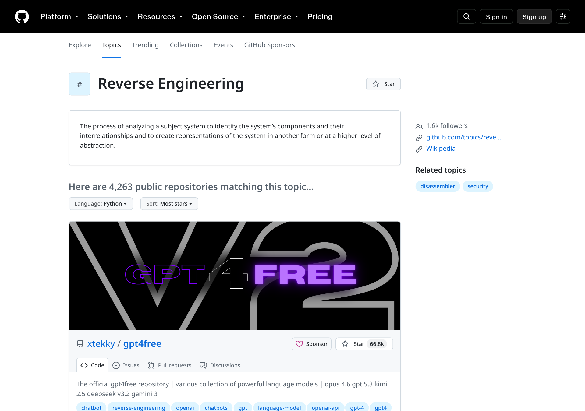

### 2.5 Step 4: read a repository card

Each card is a compact summary. Here's Ghidra's:

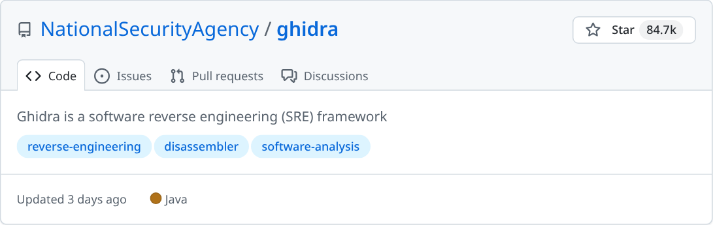

- **Owner / name**: `NationalSecurityAgency / ghidra`. *Always check the owner.* Clones and impersonators use the same repo name under a different owner.
- **Star count**: 84.7k
- **Description**: "Ghidra is a software reverse engineering (SRE) framework"
- **Topics**: `reverse-engineering`, `disassembler`, `software-analysis`
- **Updated** time and **main language** (Java)

### 2.6 Step 5: open the repo and run the trust checklist

Click the repo name. Before you download anything, go through this checklist. I'll use Ghidra as the worked example.

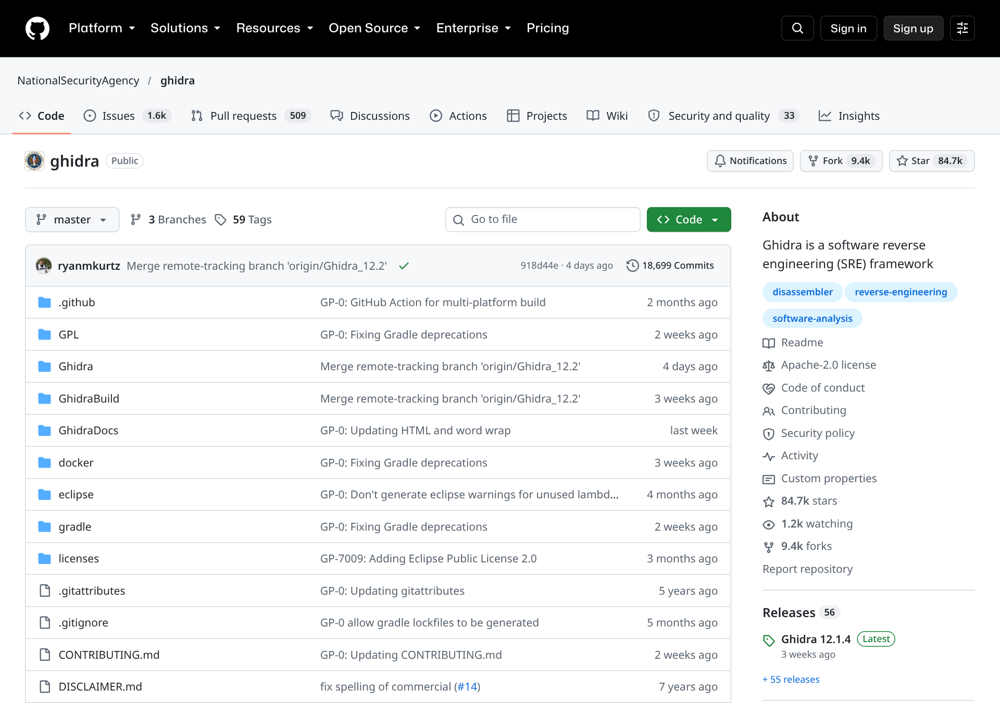

**✅ 1. Owner and URL.** Is this the official account? Ghidra lives at `github.com/NationalSecurityAgency/ghidra`, and the project's own site, <https://ghidra-sre.org/>, links there. Many projects have a website that links to the "real" GitHub repo. Cross-check in both directions.

**✅ 2. README.** Scroll down. A good README tells you what the tool does, how to install it, and its requirements. It often also warns you about security issues and fake download sites.

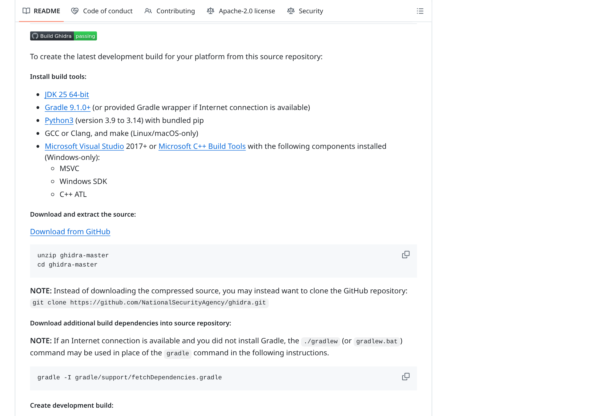

> **Receipt: READMEs differ by branch, so read the one for your version.** On Oct 12, 2026 Ghidra's `master` README said *"Install JDK 25 64-bit,"* because it describes the next development build. The README on the **`Ghidra_12.1.4_build` tag** (the current release) says *"Install JDK 21 64-bit,"* and the release's `application.properties` contains `application.java.min=21`. For the release you download today, **JDK 21 or newer** is the requirement.

The README also has a **Security Warning**: *"There are known security vulnerabilities within certain versions of Ghidra,"* with a link to the project's [Security Advisories](https://github.com/NationalSecurityAgency/ghidra/security/advisories). Translation: stay on current releases.

**✅ 3. License.** It's in the right sidebar under "About" (Ghidra: **Apache-2.0 license**). The license tells you what you may legally do with the *tool* (use, modify, redistribute). If GitHub shows **"Other"** or the API reports `NOASSERTION`, GitHub couldn't auto-detect it, so open the `LICENSE`/`COPYING` file and read it. Examples from today:

| Repo | GitHub-detected | Actual license file says |
|---|---|---|
| x64dbg/x64dbg | NOASSERTION | GNU GPL v3 (with a note that the document was modified) |
| radareorg/radare2 | NOASSERTION | "Most of radare2 is licensed under the LGPLv3" (plugins vary) |
| frida/frida | NOASSERTION | wxWindows Library Licence 3.1 |

No license at all means default copyright applies: you can look, but you have no granted rights. GitHub's docs explain this: [Licensing a repository](https://docs.github.com/en/repositories/managing-your-repositorys-settings-and-features/customizing-your-repository/licensing-a-repository).

**✅ 4. Stars, watchers, forks.** These are signals of *popularity*, not *safety*. Popularity can be bought, botted or hyped.

> **Receipt: why stars alone mean little.** On Oct 12, 2026 the #1 repo on this topic by stars was `morluto/rea`, with **143,304 stars**. The API shows it was **created April 14, 2026**. Ghidra, public since **March 2019**, had **84,697**. I'm not claiming anything about `rea`. Fast-growing new projects can be legitimate. The point is that a star count can't tell you the difference, so you check the other signals.

**✅ 5. Recent commits.** Click the **commits** count (Ghidra showed "18,699 Commits") or the clock icon. Are there recent commits from several people? Do the messages look like real engineering work?

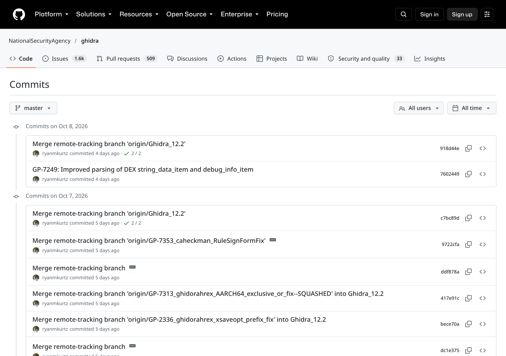

**✅ 6. Issues.** Open the **Issues** tab. Look for responsive maintainers, real bug reports, and any reports of malware or a compromised release. A big count isn't bad in itself. Ghidra had ~1.6k open issues, which is normal for a project that size. **Zero issues with issues disabled** on a "popular" repo is a yellow flag.

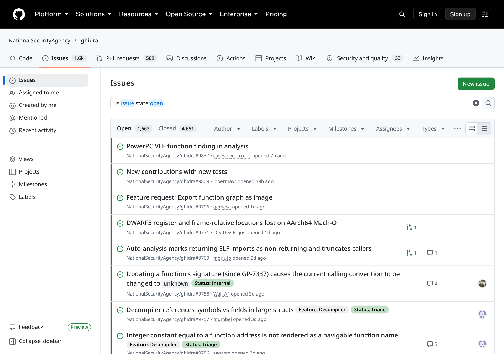

**✅ 7. Releases.** In the right sidebar, under **Releases**, the official build is attached as an **asset**. Good releases include notes and checksums. Ghidra 12.1.4 lists its SHA-256 right on the page (Figure 12).

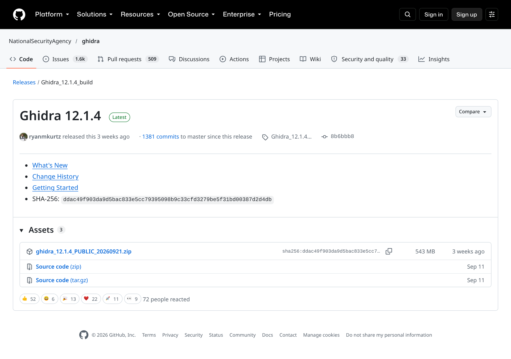

> **Note:** "Source code (zip)" and "Source code (tar.gz)" are auto-generated by GitHub and are **not** the program. Ghidra's README says so: *"Downloading either of the files named 'Source Code' is not correct for this step."*

**✅ 8. Official download source only.** Some projects warn about lookalike sites. Detect It Easy's README, for example:

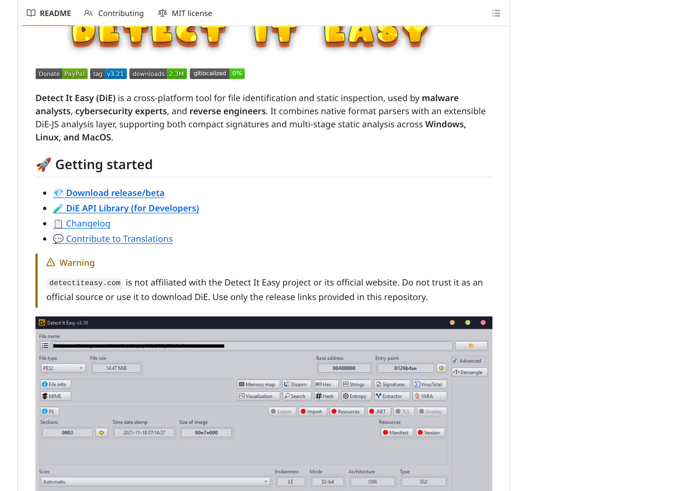

> *"`detectiteasy.com` is not affiliated with the Detect It Easy project or its official website. Do not trust it as an official source or use it to download DiE. Use only the release links provided in this repository."*

**✅ 9. Red flags. Walk away if you see:**

- A download link to a file host (Mega, Dropbox, Discord CDN) instead of GitHub Releases
- A **password-protected ZIP** from a random repo. Crackme sites do this on purpose; random "tools" shouldn't.
- Instructions to **disable your antivirus** for a "tool," or to run a one-liner that pipes a remote script into PowerShell or bash without explanation
- A brand-new account, a copy of a famous repo's README, and huge star counts with almost no commits
- Repo names like `ghidra-pro-cracked`, `ida-free-full`, `x64dbg-premium`. Real RE tools are free or sold by their vendors, not "unlocked."
- Binaries committed straight into the repo, with no source and no releases

**✅ 10. Verify the download.** Compare the file's hash with the one the project publishes (Section 4.3). Then run it **inside your VM first**.

---

## 3. A curated list of real tools from the topic page (with receipts)

All data comes from the GitHub REST API and GitHub UI on **Oct 12, 2026**. "On topic page" means the repo carries the `reverse-engineering` tag.

### 3.1 The core toolkit

| Tool | Repo | What it's for | Stars | License | Latest release (date) | On topic page? |
|---|---|---|---|---|---|---|
| **Ghidra** | [NationalSecurityAgency/ghidra](https://github.com/NationalSecurityAgency/ghidra) | Full RE suite: disassembler, **decompiler**, scripting, many CPU architectures | 84.7k | Apache-2.0 | [12.1.4](https://github.com/NationalSecurityAgency/ghidra/releases/tag/Ghidra_12.1.4_build) (Sep 21, 2026) | ✅ |
| **ImHex** | [WerWolv/ImHex](https://github.com/WerWolv/ImHex) | Hex editor for reverse engineers, with a pattern language to parse file formats | 55.1k | GPL-2.0 | [v1.38.1](https://github.com/WerWolv/ImHex/releases/tag/v1.38.1) (Dec 21, 2025) | ✅ |
| **x64dbg** | [x64dbg/x64dbg](https://github.com/x64dbg/x64dbg) | User-mode **debugger for Windows** (x86/x64). "Optimized for reverse engineering and malware analysis." | 49.8k | GPL-3.0 (see LICENSE) | [2026.05.27](https://github.com/x64dbg/x64dbg/releases/tag/2026.05.27) (May 27, 2026) | ✅ |
| **Apktool** | [iBotPeaches/Apktool](https://github.com/iBotPeaches/Apktool) | Decode and rebuild **Android APK** resources and smali | 25.8k | Apache-2.0 | [v3.0.3](https://github.com/iBotPeaches/Apktool/releases/tag/v3.0.3) (Jul 20, 2026) | ✅ |
| **radare2** | [radareorg/radare2](https://github.com/radareorg/radare2) | "UNIX-like reverse engineering framework and command-line toolset" | 25.0k | LGPLv3 (mostly) | [6.2.4](https://github.com/radareorg/radare2/releases/tag/6.2.4) (Oct 5, 2026) | ✅ |
| **Cutter** | [rizinorg/cutter](https://github.com/rizinorg/cutter) | Free, open-source **GUI** RE platform "powered by rizin" | 20.0k | GPL-3.0 | [v2.5.0](https://github.com/rizinorg/cutter/releases/tag/v2.5.0) (Jun 30, 2026) | ✅ |
| **rizin** | [rizinorg/rizin](https://github.com/rizinorg/rizin) | Fork of radare2, the engine behind Cutter | 4.0k | LGPL-3.0 | [v0.9.1](https://github.com/rizinorg/rizin/releases/tag/v0.9.1) (Jun 29, 2026) | ✅ |
| **Detect It Easy (DiE)** | [horsicq/Detect-It-Easy](https://github.com/horsicq/Detect-It-Easy) | Identify file type, **compiler, packer, protector**. Your first look at any unknown binary. | 11.7k | MIT | [3.21](https://github.com/horsicq/DIE-engine/releases/tag/3.21) (Apr 21, 2026), published in the separate **DIE-engine** repo | ✅ |
| **JADX** | [skylot/jadx](https://github.com/skylot/jadx) | **Dex-to-Java decompiler** for Android apps (GUI and CLI) | 50.9k | Apache-2.0 | [v1.5.6](https://github.com/skylot/jadx/releases/tag/v1.5.6) (Jul 10, 2026) | ❌ (tagged `android`, `decompiler`, `dex`, `java`) |
| **Frida** | [frida/frida](https://github.com/frida/frida) | **Dynamic instrumentation**: inject JavaScript into running processes to hook functions | 22.2k | wxWindows Lib. Licence 3.1 | [17.23.3](https://github.com/frida/frida/releases/tag/17.23.3) (Oct 9, 2026) | ❌ (tagged `frida`, `instrumentation`, `vala`) |

> **Receipt on Detect It Easy:** the `horsicq/Detect-It-Easy` repo's own "Releases" only holds database and beta snapshots. Its README says "Download release/beta" and links to **<https://github.com/horsicq/DIE-engine/releases>**. A good example of why you read the README before you click a random "Release."

### 3.2 What each one is *for* (beginner translation)

- **"What is this file?"** → **Detect It Easy.** Is it a PE, an ELF or a Mach-O? 32- or 64-bit? Packed with UPX? Built with which compiler? Run it first, every time.
- **"Show me the code."** → **Ghidra** (or **Cutter**/**radare2**). Static analysis: disassembly plus decompiled pseudocode, and you never run the program.
- **"Show me what it does while it runs."** → **x64dbg** on Windows, **GDB** on Linux, ideally with **[pwndbg](https://github.com/pwndbg/pwndbg)** (11.0k★, MIT) or **[GEF](https://github.com/hugsy/gef)** (8.4k★, MIT). Both are also on the topic page under the Python filter.
- **"Show me the raw bytes / parse this file format."** → **ImHex.**
- **"It's an Android app."** → **JADX** to read the Java, **Apktool** to decode and rebuild resources, **Frida** to hook it at runtime on a test device you own.
- **"I want to script the whole thing."** → Ghidra (Java/Python via PyGhidra), radare2 (`r2pipe`), Frida (JavaScript).

### 3.3 Other notable repos on the page (learning, not tools)

- **[mytechnotalent/Reverse-Engineering](https://github.com/mytechnotalent/Reverse-Engineering)**: *"A FREE comprehensive reverse engineering tutorial covering x86, x64, 32-bit/64-bit ARM, 8-bit AVR and 32-bit RISC-V architectures."* 14.6k★, Apache-2.0.
- **[OWASP/mastg](https://github.com/OWASP/mastg)**: the OWASP Mobile Application Security Testing Guide, the standard reference for mobile app RE and security testing. 13.2k★, CC-BY-SA-4.0. Readable at <https://mas.owasp.org/MASTG/>.
- **Awesome lists** such as [Hack-with-Github/Awesome-Hacking](https://github.com/Hack-with-Github/Awesome-Hacking) are huge link directories. Use them for discovery, and apply the Section 2.6 checklist to every link you follow from them.

### 3.4 Commercial tools you'll hear about (not on GitHub)

Crackmes.one's FAQ also lists **IDA Pro** (with a free version) and **Binary Ninja** as disassemblers/decompilers, and **WinDbg** and **LLDB** as debuggers. You don't need any of them to start. Ghidra plus a debugger covers everything in this guide.

---

## 4. Hands-on: install Ghidra and solve your first crackme

**What you'll do:** set up a safe VM, install JDK 21+ and Ghidra 12.1.4, build a tiny practice crackme, then use Ghidra to find the password **without reading the source code**.

**Time:** 45-90 minutes the first time.
**Difficulty:** total beginner. If you can copy/paste commands, you can do this.

```text
DIAGRAM (not a screenshot): the workflow we'll follow

  [ Safe VM ] --> [ JDK 21+ ] --> [ Ghidra 12.1.4 (verify SHA-256) ]
                                          |
  [ crackme binary ] --> Import --> Auto-analyze --> Find main
                                          |
                    Read decompiler --> Rename things --> Find the check
                                          |
                        Recover password --> Test it --> Write it up
```

### 4.1 What you need

| Requirement | Detail (source) |
|---|---|
| RAM | **4 GB minimum** (Ghidra Getting Started). Give your VM 6-8 GB if you can. |
| Disk | **1 GB** for Ghidra itself. The zip is **543 MB**. Plan ~3 GB with the JDK and projects. |
| Java | **JDK 21, 64-bit** (Getting Started; `application.java.min=21`) |
| Python (optional) | 3.9-3.14, only for PyGhidra and the debugger |
| OS | Windows, Linux, or macOS 10.13+ (64-bit) |

### 4.2 Step 1: set up a safe VM (do not skip)

**Why?** Your own crackme is harmless. Crackmes from the internet are reviewed but not guaranteed. Crackmes.one's FAQ says *"there is always a small chance that something could be missed,"* and it recommends:

- *"Always run crackmes in an isolated environment like VirtualBox, VMware, or Hyper-V."*
- *"Take snapshots... so you can easily restore to a clean state."*
- *"Consider disabling network access in your VM."*

**Pick a hypervisor (free options):**

- **[VirtualBox](https://www.virtualbox.org/wiki/Downloads)**: Windows, Linux, macOS (Intel)
- **[VMware Workstation / Fusion](https://www.vmware.com/products/desktop-hypervisor/workstation-and-fusion)**
- **Hyper-V**, built into Windows Pro/Enterprise ([enable Hyper-V](https://learn.microsoft.com/en-us/virtualization/hyper-v-on-windows/quick-start/enable-hyper-v))
- **[Windows Sandbox](https://learn.microsoft.com/en-us/windows/security/application-security/application-isolation/windows-sandbox/windows-sandbox-overview)**: a disposable Windows desktop that resets when you close it (Windows Pro/Enterprise)

**Pick a guest OS:**

- **Linux guest (easiest for this tutorial):** [Ubuntu Desktop](https://ubuntu.com/download/desktop) or [Debian](https://www.debian.org/distrib/). Optional specialty distro: [REMnux](https://remnux.org/), a Linux toolkit for malware analysis.
- **Windows guest:** a normal Windows 10/11 VM. Optional: Mandiant's [FLARE-VM](https://github.com/mandiant/flare-vm) script turns a Windows VM into an RE workstation. Read its README first, because it changes a lot of system settings.

**VM hygiene checklist:**

1. Create the VM. Give it 2+ CPUs, 6-8 GB RAM and 60 GB disk.
2. Install the OS and updates **while the network is on**.
3. Download Ghidra, the JDK and your crackme **into the VM**.
4. **Take a snapshot** and name it `clean-tools-installed`.
5. Before you run any downloaded crackme, **disconnect the VM's network adapter**. In VirtualBox: *Settings → Network → uncheck "Cable Connected"*, or set it to *Not attached*.
6. **Disable shared folders and shared clipboard/drag-and-drop** for untrusted samples.
7. When you're done, **revert to the snapshot**.

### 4.3 Step 2: install Java (JDK 21+)

Ghidra recommends free LTS builds from **[Adoptium Temurin](https://adoptium.net/temurin/releases)** or **[Amazon Corretto](https://docs.aws.amazon.com/corretto/latest/corretto-21-ug/downloads-list.html)**.

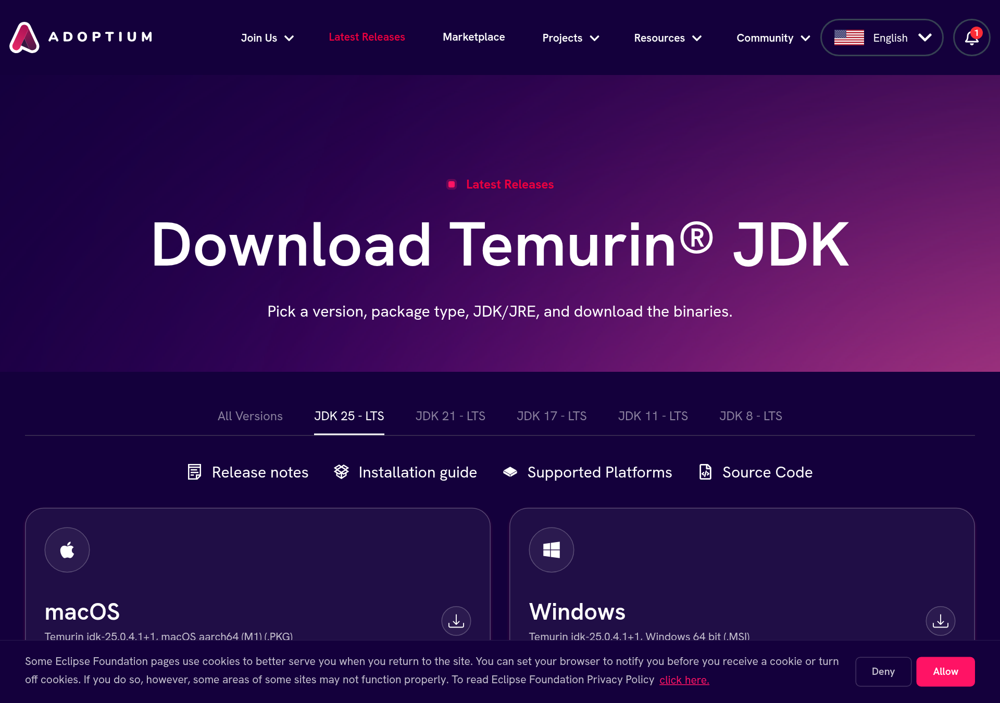

> **Note:** Adoptium's page now defaults to **JDK 25 LTS**. Ghidra 12.1.4 declares a **minimum** of Java 21 and no maximum (`application.java.max=` is empty). JDK 21 is the version the 12.1.4 docs name explicitly, so it's the safest choice. Pick the **JDK** (not JRE), **x64**.

**Windows:**

Option A, installer: download the Temurin **JDK 21 x64 `.msi`** and run it. On the custom setup screen, enable **"Add to PATH"** and **"Set JAVA_HOME."**

Option B, winget (PowerShell or Terminal):

```powershell
winget install --id EclipseAdoptium.Temurin.21.JDK --exact
```

Then open a **new** terminal and check:

```powershell
java -version
```

**Linux (Debian/Ubuntu):**

```bash
sudo apt update
sudo apt install -y openjdk-21-jdk
java -version
```

On my Debian 13 lab box, `java -version` printed:

```text
openjdk version "21.0.12.1" 2026-08-18
```

(Fedora: `sudo dnf install java-21-openjdk-devel`. Arch: `sudo pacman -S jdk21-openjdk`.)

### 4.4 Step 3: download Ghidra from the official GitHub release, and verify it

1. Go to **<https://github.com/NationalSecurityAgency/ghidra/releases>** and open the release marked **Latest**. On Oct 12, 2026 that was **Ghidra 12.1.4**, released Sep 21, 2026.
2. Under **Assets**, download **`ghidra_12.1.4_PUBLIC_20260921.zip`** (543 MB). Do **not** take "Source code."
   Direct link: <https://github.com/NationalSecurityAgency/ghidra/releases/download/Ghidra_12.1.4_build/ghidra_12.1.4_PUBLIC_20260921.zip>
3. Copy the SHA-256 shown on the release page:
   `ddac49f903da9d5bac833e5cc79395098b9c33cfd3279be5f31bd00387d2d4db`


**Verify on Windows (PowerShell):**

```powershell
cd $HOME\Downloads
Get-FileHash .\ghidra_12.1.4_PUBLIC_20260921.zip -Algorithm SHA256
```

Compare the `Hash` value with the one on the release page. Case doesn't matter. Every character must match.

**Verify on Linux:**

```bash
cd ~/Downloads
echo "ddac49f903da9d5bac833e5cc79395098b9c33cfd3279be5f31bd00387d2d4db  ghidra_12.1.4_PUBLIC_20260921.zip" | sha256sum -c
```

Expected output (this is what I got):

```text
ghidra_12.1.4_PUBLIC_20260921.zip: OK
```

### 4.5 Step 4: extract and launch Ghidra

Ghidra has **no installer**. You just extract it. Per Getting Started: *"Do not extract Ghidra on top of an existing installation."*

**Windows:**

1. Right-click the zip → **Extract All...** → choose something like `C:\Tools\` (avoid `C:\` itself; Getting Started notes admin rights may be needed there).
2. Open `C:\Tools\ghidra_12.1.4_PUBLIC\` and double-click **`ghidraRun.bat`**.

**Linux:**

```bash
mkdir -p ~/tools && cd ~/tools
unzip ~/Downloads/ghidra_12.1.4_PUBLIC_20260921.zip
cd ghidra_12.1.4_PUBLIC
./ghidraRun
```

If Ghidra can't find Java, it asks for the JDK's home folder (the parent of the `bin` directory).

**First launch:**

1. Read the **User Agreement** (Figure 1) and click **I Agree**.
2. A **Tip of the Day** and a **Help** window may open. Close them.
3. You'll land on the **Project window**:

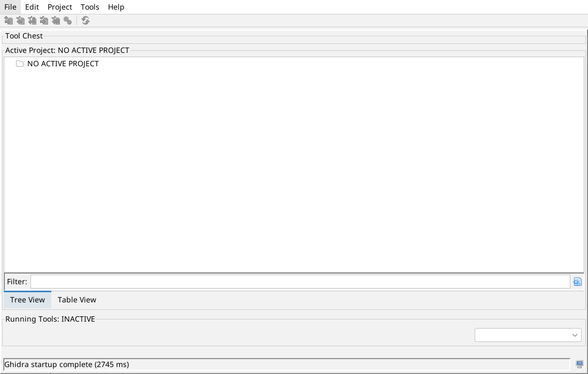

### 4.6 Step 5: get a legal crackme

You have two good options.

**Option A (recommended for this tutorial): build the practice crackme yourself.** It's 100% legal (you wrote it), 100% safe, and it matches every screenshot below.

1. Copy the C code from **Appendix A** into a file named `crackme.c`. *Try not to read it closely. The fun is finding the password with Ghidra.*
2. Compile it:

**Linux:**

```bash
sudo apt install -y build-essential   # gcc + make
gcc -O0 -o crackme crackme.c
strip crackme                         # remove symbol names so it's a real challenge
./crackme
```

**Windows:** pick one.

- **WSL (simplest):** install WSL ([Microsoft guide](https://learn.microsoft.com/en-us/windows/wsl/install)) with `wsl --install`, open Ubuntu, and run the Linux commands above. Ghidra on Windows can analyze the resulting Linux binary just fine. Static analysis never runs the program.
- **MSYS2 / MinGW-w64 (native `.exe`):** install [MSYS2](https://www.msys2.org/), open the **UCRT64** shell, then:

  ```bash
  pacman -S mingw-w64-ucrt-x86_64-gcc
  gcc -O0 -s -o crackme.exe crackme.c
  ./crackme.exe
  ```

  (`-s` strips symbols, like `strip` on Linux.)

**Option B: download a beginner crackme from [crackmes.one](https://crackmes.one/).**

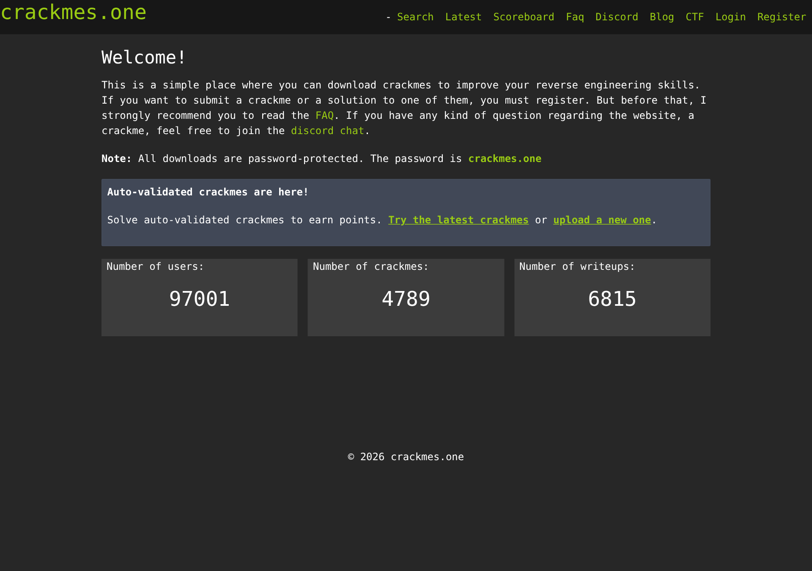

1. Use **Search** and filter for **difficulty 1** (the FAQ recommends this for beginners). Match the platform (Windows/Linux) and language (C/C++ is easiest to start with).
2. Read the description and the comments from other users.
3. Download it **inside your VM**. Archives are password-protected on purpose. The site says *"The password is crackmes.one."*
4. Antivirus alerts on crackmes are common. Per the FAQ they *"often use techniques that are similar to those found in malware."* That's exactly why you're in a VM with the network off.
5. Crackmes.one etiquette: when you submit a solution, write a real **writeup**, not just the password. Patch-only solutions are generally rejected.

### 4.7 Step 6: create a project and import the binary

1. In the Project window: **File → New Project...** (or `Ctrl+N`).
2. Select **Non-Shared Project** → **Next**.

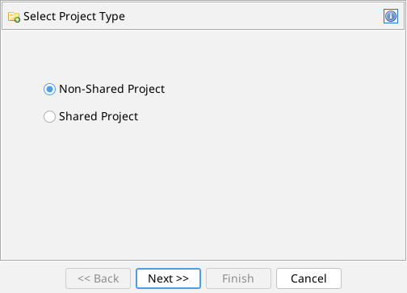

3. Choose a **Project Directory** and type a **Project Name**, e.g. `CrackmeLab` → **Finish**.

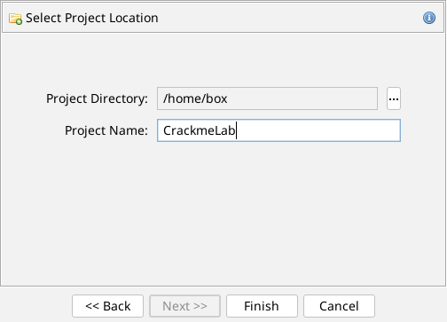

4. **File → Import File...** (or press `I`). Browse to your `crackme` (or `crackme.exe`) → **Select File To Import**.

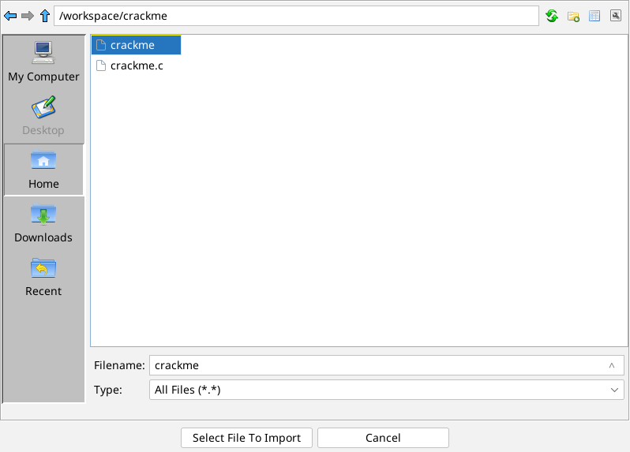

5. Ghidra detects the format. For the Linux build: **Format: Executable and Linking Format (ELF)**, **Language: x86:LE:64:default:gcc**. Leave the defaults → **OK**.

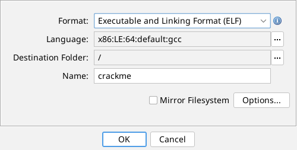

6. Read the **Import Results Summary**. It's a free information dump: architecture, compiler, number of functions, the binary's MD5/SHA-256, and required libraries (`libc.so.6`). For my build Ghidra reported 19 functions, "Compiler ID: gcc," and "GCC: (Debian 14.2.0-19) 14.2.0." → **OK**.

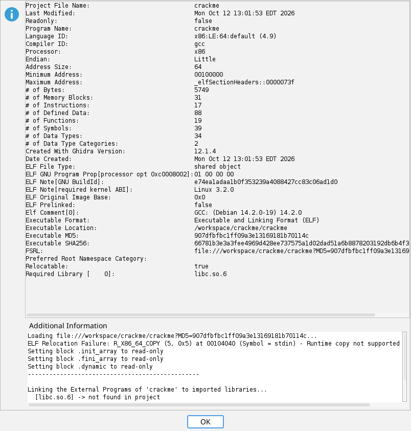

> A Windows `.exe` shows **Portable Executable (PE)** and something like `x86:LE:64:default:windows` instead. Everything else is the same.

### 4.8 Step 7: auto-analyze

1. **Double-click** `crackme` in the project tree. The **CodeBrowser** opens.
2. Ghidra asks: *"crackme has not been analyzed. Would you like to analyze it now?"* → **Yes**.

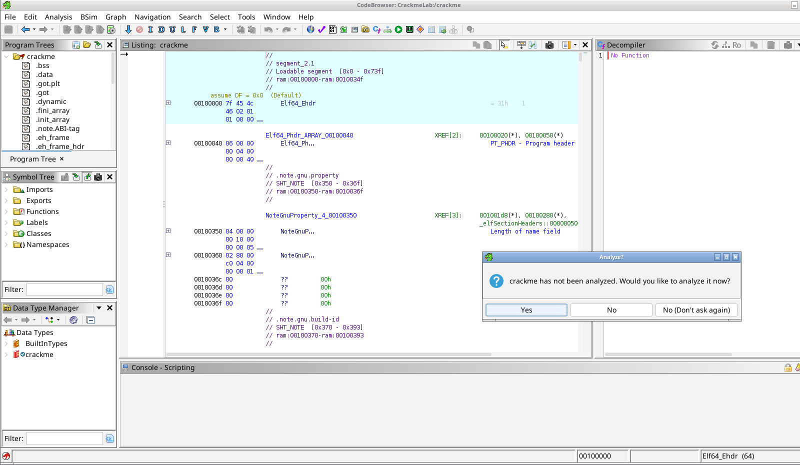

3. The **Analysis Options** dialog lists dozens of analyzers. **Leave the defaults** → **Analyze**. For a tiny binary this takes seconds. My headless run reported `Total Time 1 secs`. Watch the progress bar in the bottom-right corner.

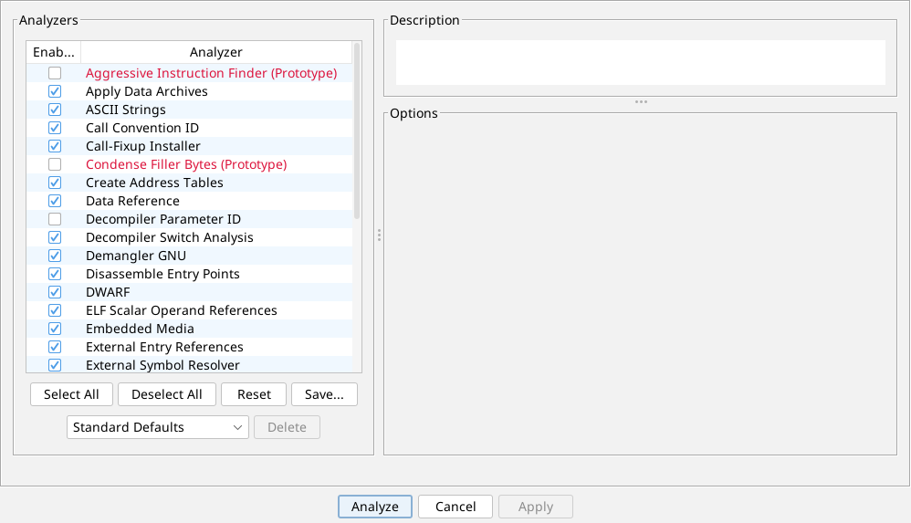

**A quick tour of the CodeBrowser** (Figures 25-29):

- **Left top, Program Trees:** the binary's sections (`.text` is code, `.rodata` is read-only data such as strings)
- **Left middle, Symbol Tree:** Imports, Exports, **Functions**, Labels
- **Center, Listing:** the disassembly. Address | bytes | instruction.
- **Right, Decompiler:** C-like pseudocode for whatever function your cursor is in
- **Bottom, Console:** script output

### 4.9 Step 8: find `main` (in a stripped binary)

Because we stripped the binary, there's no function called `main` in the Symbol Tree. Ghidra names unknown functions `FUN_<address>`. Here's how a pro finds `main` in a Linux ELF:

1. In **Symbol Tree → Exports**, click **`entry`**. That's the very first code the OS runs. You can also click the `entry` function in the Listing.
2. Look at the **Decompiler**. On Linux/glibc, `entry` (a.k.a. `_start`) calls **`__libc_start_main`**, and its **first argument is the address of `main`**:

```c
void processEntry entry(undefined8 param_1,undefined8 param_2)
{
  undefined1 auStack_8 [8];

  (*(code *)PTR___libc_start_main_00103fc0)
            (FUN_001011f5,param_2,&stack0x00000008,0,0,param_1,auStack_8);
  do {
                    /* WARNING: Do nothing block with infinite loop */
  } while( true );
}
```

*(Exact output from my Ghidra 12.1.4 headless run. The GUI shows it as `__libc_start_main(FUN_001011f5, ...)`.)*

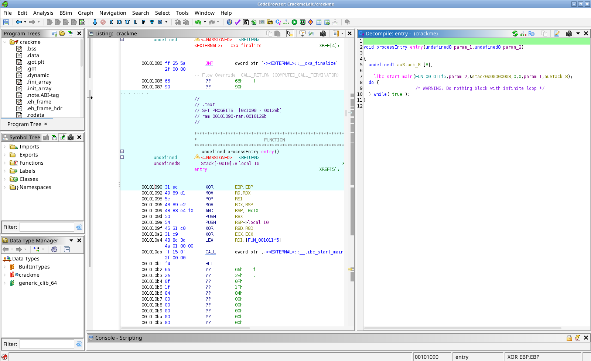

3. **Double-click `FUN_001011f5`** in the decompiler to jump there. `Alt+←` takes you back if you misclick.

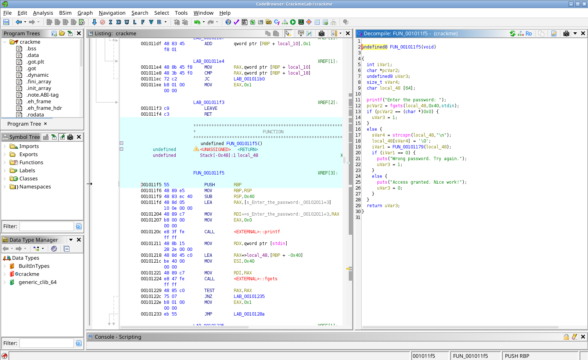

**Alternative route (works for almost any crackme): follow the strings.**
Open **Window → Defined Strings**, filter for `Access` or `Wrong`, double-click the string, then follow its **XREF** (cross-reference) back to the function that uses it. That function is (or calls) the password check.

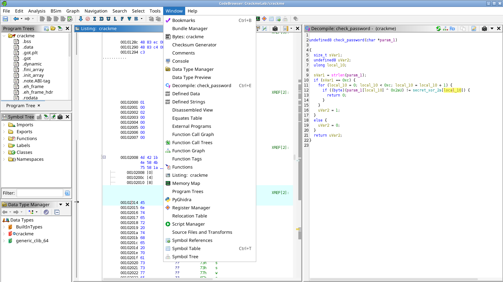

> **Windows `.exe` note (receipt from a MinGW-w64 build I analyzed the same way):** `entry` calls a big C-runtime startup function (`FUN_140001180` in my build). Inside it, look for the call that comes **right after `__getmainargs`** and right before `exit()`. That call is `main(argc, argv, envp)`. In my build it was `FUN_140001524(...)`. MSVC-built binaries use a different CRT layout, but the idea is the same: walk from `entry` through the runtime until you find the call whose return value gets passed to `exit`.

### 4.10 Step 9: read the decompiler and rename things

The decompiler's names are placeholders. **Renaming is how you build understanding.** Every name you fix makes the next line easier to read.

**Rename the function to `main`:**

1. Click `FUN_001011f5` on the function signature line in the Decompiler.
2. Press **`L`** (rename / "Edit Label"). Or right-click → **Rename Function**.
3. Type `main` → **OK**.

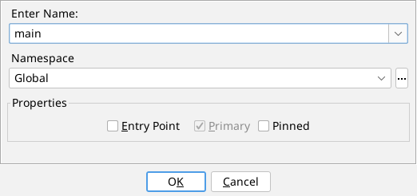

**Rename variables the same way:**

- Click `local_48` (declared as `char local_48 [64];`), press **`L`**, and type `input`. It's the 64-byte buffer `fgets` fills.
- Click `FUN_00101179` (the function whose result decides "granted" vs "wrong"), press **`L`**, and type `check_password`.

Here's the result. Same code, now readable:

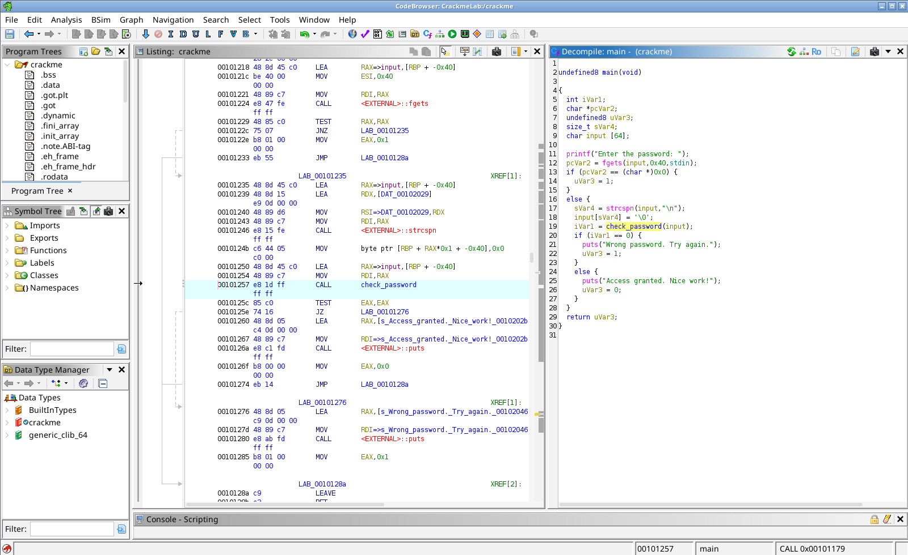

```c
undefined8 main(void)
{
  ...
  char input [64];

  printf("Enter the password: ");
  pcVar2 = fgets(input,0x40,stdin);
  if (pcVar2 == (char *)0x0) {
    uVar3 = 1;
  }
  else {
    sVar4 = strcspn(input,"\n");
    input[sVar4] = '\0';
    iVar1 = check_password(input);
    if (iVar1 == 0) {
      puts("Wrong password. Try again.");
      uVar3 = 1;
    }
    else {
      puts("Access granted. Nice work!");
      uVar3 = 0;
    }
  }
  return uVar3;
}
```

**How to read this as a beginner:**

- `0x40` is hex for **64**, the buffer size.
- `strcspn(input,"\n")` finds the newline, and `input[...] = '\0'` chops it off. This is standard input cleanup.
- Everything hinges on `check_password(input)`. **That's our target.**

**Other renaming and retyping tips:**

- **`Ctrl+L`** on a variable = **Retype Variable**, e.g. change `undefined8` to `int` or `bool`.
- **`;`** adds a comment at the current address in the Listing. Write down what you learn.
- **`File → Save`** (`Ctrl+S`) saves your renames into the project.

### 4.11 Step 10: find and understand the password check

Double-click `check_password` to open it:

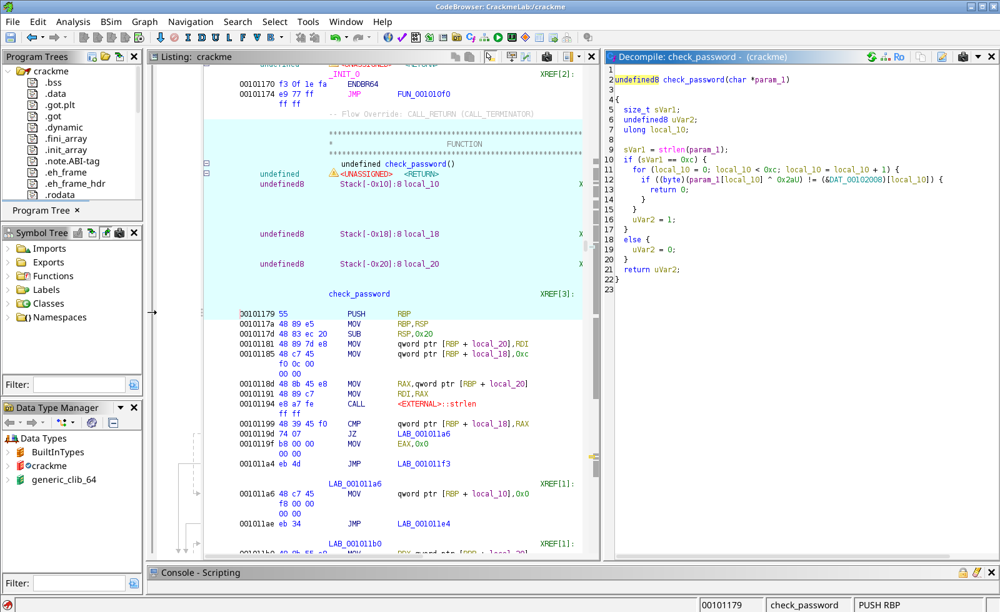

```c
undefined8 check_password(char *param_1)
{
  size_t sVar1;
  undefined8 uVar2;
  ulong local_10;

  sVar1 = strlen(param_1);
  if (sVar1 == 0xc) {
    for (local_10 = 0; local_10 < 0xc; local_10 = local_10 + 1) {
      if ((byte)(param_1[local_10] ^ 0x2aU) != (&DAT_00102008)[local_10]) {
        return 0;
      }
    }
    uVar2 = 1;
  }
  else {
    uVar2 = 0;
  }
  return uVar2;
}
```

**Line-by-line, in English:**

1. `strlen(param_1) == 0xc` → the password must be **12 characters** (0xc = 12).
2. The loop runs over each character `i` from 0 to 11.
3. `param_1[i] ^ 0x2a` → **XOR** each input character with `0x2A`.
4. `!= DAT_00102008[i]` → compare it with byte `i` of a hidden array at address `0x00102008`. Any mismatch → `return 0` (wrong).
5. All 12 match → `return 1` (correct).

So the password isn't stored as plain text (the `strings` command won't show it). It's stored **XOR-encoded**. XOR has a nice property: if `input ^ 0x2A == secret`, then `input == secret ^ 0x2A`. We just need the 12 secret bytes.

The same logic is visible in the **Listing** (assembly). Click inside the loop and you'll see the `XOR EAX,0x2a` instruction, then a `CMP DL,AL` against a byte loaded from `DAT_00102008`:

![Figure 31. Listing view of the loop: MOVZX → XOR EAX,0x2a → LEA RCX,[DAT_00102008] → CMP DL,AL → JZ.](img/30-ghidra-listing-xor-0x2a.png)

### 4.12 Step 11: extract the secret bytes

1. Press **`G`** (Go To), type `00102008`, press **Enter**. You can also just double-click `DAT_00102008` in the decompiler.

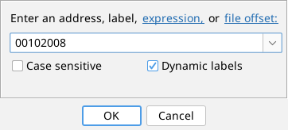

2. You land in `.rodata`. You'll see bytes `4d 42 1b 4e 58 4b 75 58 1a ...`


> **Receipt: decompilers and analyzers guess, and sometimes they guess wrong.** In my run, Ghidra's string analyzer merged the **last three secret bytes** (`0x49 0x41 0x59`, which happen to be printable ASCII "IAY") into the next string, so the listing showed `"IAYEnter the password: "`. The loop bound `0xc` says the array is 12 bytes, so trust the code over the auto-labeling.

3. Fix the data type so Ghidra shows exactly 12 bytes: click the first byte at `00102008`, press **`B`** (define as byte), then press **`[`** (Create Array), enter **12**, and confirm the "overwrite existing data" prompt. (This is our own lab copy, so overwriting the mis-guessed string is fine.)
4. Rename the label with **`L`** to something meaningful, e.g. `secret_xor_2a`. Expand the array with the **+** icon:

![Figure 34. The secret as a byte[12] array named secret_xor_2a. The decompiler now reads `!= secret_xor_2a[local_10]`.](img/33-ghidra-secret-array-12-bytes.png)

The 12 bytes are:

```text
4D 42 1B 4E 58 4B 75 58 1A 49 41 59
```

### 4.13 Step 12: recover the password and test it

XOR every byte with `0x2A`. Use Python (preinstalled on most Linux; on Windows install it from [python.org](https://www.python.org/)):

```bash
python3 -c "secret=bytes.fromhex('4d421b4e584b75581a494159'); print(''.join(chr(b ^ 0x2a) for b in secret))"
```

Output:

```text
gh1dra_r0cks
```

Test it (inside your VM):

```text
$ echo "gh1dra_r0cks" | ./crackme
Enter the password: Access granted. Nice work!
```

You just reversed a stripped binary: you found `main` from the entry point, identified the check, decoded an obfuscated secret, and proved it. **That's the core RE loop.** Real crackmes add layers (anti-debugging, packing, custom algorithms), but the loop doesn't change.

### 4.14 Step 13: write it up (the habit that makes you good)

Crackmes.one won't accept "the password is X" as a writeup, and neither should you. A short writeup template:

```markdown
# <crackme name> - writeup
- Target: <file>, SHA-256 <hash>, <ELF/PE>, <arch>, stripped? <y/n>
- Tools: Ghidra 12.1.4, JDK 21, <VM details>
## Recon
- DiE / file / strings results
## Finding main
- entry → __libc_start_main(FUN_...) → main
## The check
- Length must be 12; each char XOR 0x2A compared to 12-byte array at 0x00102008
## Solution
- Decoded bytes → password; tested → "Access granted"
## What I learned
```

### 4.15 Troubleshooting

| Problem | Fix |
|---|---|
| "Unable to find a supported JDK" / Ghidra asks for a JDK path | Install a **JDK** (not JRE) 21+. Point Ghidra at the folder that *contains* `bin`. |
| Ghidra is very slow or crashes on big binaries | Give the VM more RAM. 4 GB is the stated *minimum*. |
| Decompiler pane says "No Function" | Your cursor is in data or between functions. Click inside a function in the Listing. |
| Windows crackme says "VCRUNTIME140.dll not found" | Install the Microsoft Visual C++ Redistributable (x86 **and** x64), per crackmes.one's FAQ. |
| Hash doesn't match | **Don't run it.** Re-download from the official release page. |
| Accidentally clicked the wrong thing | `Ctrl+Z` undoes most edits. `Alt+←` goes back in navigation. |

---

## 5. Next steps and learning resources

**Practice targets (legal by design)**

- **crackmes.one**: <https://crackmes.one/>. Start at difficulty 1 and read others' writeups after each attempt. Rules and safety: <https://crackmes.one/faq>.
- **picoCTF**: <https://picoctf.org/>. Beginner-friendly CTF with a "Reverse Engineering" category.
- **CTFtime**: <https://ctftime.org/>. Calendar of CTF events worldwide.
- **Microcorruption**: <https://microcorruption.com/>. Browser-based embedded-RE game.
- GitHub topics to browse next: <https://github.com/topics/crackme> and <https://github.com/topics/ctf>.

**Courses and books (free)**

- **OpenSecurityTraining2**: <https://ost2.fyi/>. Free, self-paced x86-64 assembly, RE and debugging classes.
- **pwn.college**: <https://pwn.college/>. Free, hands-on; includes RE and binary exploitation modules.
- **Reverse Engineering for Beginners** (Dennis Yurichev): <https://beginners.re/>
- **mytechnotalent/Reverse-Engineering**: <https://github.com/mytechnotalent/Reverse-Engineering>. Free multi-architecture tutorial (on the topic page).
- **Malware Unicorn RE101**: <https://www.malwareunicorn.org/workshops/re101.html>
- **OWASP MASTG** (mobile RE): <https://mas.owasp.org/MASTG/>

**Ghidra-specific**

- Getting Started for 12.1.4: <https://github.com/NationalSecurityAgency/ghidra/blob/Ghidra_12.1.4_build/GhidraDocs/GettingStarted.md>
- **GhidraClass** (official training material in the repo): <https://github.com/NationalSecurityAgency/ghidra/tree/master/GhidraDocs/GhidraClass>. Your Ghidra install also has a `docs/` folder.
- Security advisories, so you know when to update: <https://github.com/NationalSecurityAgency/ghidra/security/advisories>

**Other tools' docs**

- radare2 book: <https://book.rada.re/> · rizin: <https://rizin.re/> · Cutter: <https://cutter.re/>
- x64dbg: <https://x64dbg.com/> · ImHex: <https://imhex.werwolv.net/>
- Frida docs: <https://frida.re/docs/home/>

**A suggested 30-day path**

1. **Week 1:** redo this tutorial with `-O2` instead of `-O0` and compare how the decompiler output changes. Then try 3 difficulty-1 crackmes.
2. **Week 2:** learn basic x86-64 assembly (OST2 or *RE for Beginners*). Read the Listing alongside the Decompiler.
3. **Week 3:** add a debugger. Use GDB + pwndbg/GEF on Linux or x64dbg on Windows. Set a breakpoint on the compare and watch the bytes.
4. **Week 4:** do a picoCTF RE set and publish one proper writeup.

**Keep your receipts.** For every sample, log the SHA-256, the tool versions, and what you observed and where (addresses). That's what turns "I think" into "here's the proof."

---

## 6. X-ready teaser post

> GitHub's reverse-engineering topic lists 14,180 repos. The #1 by stars is 6 months old. Stars aren't proof.
>
> New guide: vet RE tools (license, commits, issues, releases, SHA-256), then solve your first crackme in Ghidra 12.1.4. Real screenshots, receipts included. 🧵👇

*(267 characters, about 269 as X counts emoji, so under the 280 limit. Attach Figure 25 or Figure 34 as the image and put the link in the first reply.)*

---

## 7. Appendix A: crackme source code (spoilers!)

Save as `crackme.c`. The comment gives away the scheme, so solve it in Ghidra first.

```c
/* crackme.c - a tiny, harmless practice "crackme" you build yourself.
 * Goal for the reverser: find the password WITHOUT reading this file. */
#include <stdio.h>
#include <string.h>

static const unsigned char secret[] = {
    0x4d, 0x42, 0x1b, 0x4e, 0x58, 0x4b, 0x75, 0x58, 0x1a, 0x49, 0x41, 0x59
};  /* each byte is (password_char XOR 0x2A) */

static int check_password(const char *input) {
    size_t n = sizeof(secret);
    if (strlen(input) != n)
        return 0;
    for (size_t i = 0; i < n; i++) {
        if ((unsigned char)(input[i] ^ 0x2A) != secret[i])
            return 0;
    }
    return 1;
}

int main(void) {
    char buf[64];
    printf("Enter the password: ");
    if (!fgets(buf, sizeof(buf), stdin))
        return 1;
    buf[strcspn(buf, "\n")] = '\0';
    if (check_password(buf)) {
        puts("Access granted. Nice work!");
        return 0;
    }
    puts("Wrong password. Try again.");
    return 1;
}
```

**My build, for comparison:** `gcc (Debian 14.2.0-19) 14.2.0`, `gcc -O0 -o crackme crackme.c && strip crackme`.
SHA-256 of my stripped binary: `66781b3e3a3fee4969d428ee737575a1d02dad51a6b8878203192db6b4f39c92`. Yours will likely differ with a different compiler version, and the addresses (`0x001011f5`, `0x00102008`) may differ too. The *structure* stays the same.

---

## 8. Appendix B: what I checked, and how

- **Topic page** (14,180 repos, sort options, language counts, top-20 by stars): loaded live in headless Chrome on Oct 12, 2026; menu URLs read from the page itself.
- **Stars, licenses, created/pushed dates, topics**: GitHub REST API `GET /repos/{owner}/{repo}`, same day.
- **Latest releases**: GitHub REST API `GET /repos/{owner}/{repo}/releases/latest`, same day. Ghidra 12.1.4 = `Ghidra_12.1.4_build`, published 2026-09-21; asset `ghidra_12.1.4_PUBLIC_20260921.zip` (569,649,598 bytes); SHA-256 verified locally = `OK`.
- **JDK requirement**: Ghidra 12.1.4 `GettingStarted.md` ("Java 21 64-bit Runtime and Development Kit"), the tag's README ("Install JDK 21 64-bit"), and `Ghidra/application.properties` (`application.java.min=21`).
- **Ghidra screenshots**: Ghidra 12.1.4 GUI on OpenJDK 21.0.12.1 (Debian 13, X11). Decompiler snippets were cross-checked against a headless run (`support/analyzeHeadless`) of the same binary.
- **crackmes.one quotes**: <https://crackmes.one/faq> and the home page, Oct 12, 2026.
- **All other links**: HTTP-checked on Oct 12, 2026. A few GitHub topic URLs rate-limited my automated checker (HTTP 429), but they loaded normally in the browser.

*Nothing here was published automatically. Corrections welcome. Show me the receipt.*
