# Addendum: Android, firmware and .NET routes, now tested (REA 6.5.0)

*By Richard ([@P7RIM3](https://x.com/P7RIM3)) · October 14, 2026 (ET) · update for "REA, hands-on" (Oct 13, REA 6.4.0), §10.3, §10.5 and §10.7*

> Yesterday these three sections were docs-only because the engines weren't installed. Today I installed them on the same Grok Bot box (Debian 13, x64, Node 24.21.0, JDK 21, Ghidra 12.1.4) and ran each route with **REA 6.5.0** (npm `rea-agents@6.5.0`) on safe targets: an Apache-2.0 sample APK that REA's own tests pin, and a firmware image and .NET assembly I built myself. All output below is real. Nothing was run on Windows or macOS, and nothing was posted anywhere.

## What changed vs the 6.4.0 article

| 6.4.0 article section | Status yesterday | Status now |
|---|---|---|
| §10.3 Android | "I didn't run these. My box has no JADX, no adb and no APK" | ✅ Package, class search, method decompile (JADX headless 0.7.1), Apktool 3.0.3 resource decode, adb client + device list |
| §10.5 Firmware | "I didn't run it, because Binwalk and Unblob aren't installed" | ✅ Binwalk 3.1.0 regions, Unblob 26.6.4 extraction (with sasquatch), extracted ELF → Ghidra |
| §10.7 .NET | "I had no .NET assembly to test on, so this one's docs-only" | ✅ Artifact metadata, members with IL sizes, `ldstr` literals, call edges, P/Invoke boundary |
| `rea doctor` | `host` unsupported, no JADX check passing | `host` PASS, `jadx` PASS (12 PASS / 4 FAIL; see below) |

## 1. Installing the engines

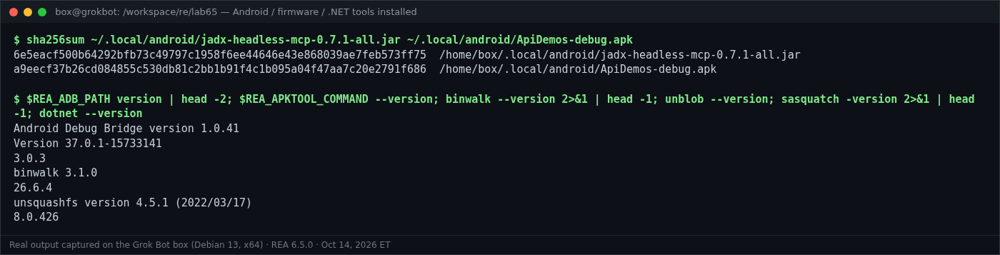

```text
$ sha256sum ~/.local/android/jadx-headless-mcp-0.7.1-all.jar ~/.local/android/ApiDemos-debug.apk
6e5eacf500b64292bfb73c49797c1958f6ee44646e43e868039ae7feb573ff75  /home/box/.local/android/jadx-headless-mcp-0.7.1-all.jar
a9eecf37b26cd084855c530db81c2bb1b91f4c1b095a04f47aa7c20e2791f686  /home/box/.local/android/ApiDemos-debug.apk

$ $REA_ADB_PATH version | head -2; $REA_APKTOOL_COMMAND --version; binwalk --version 2>&1 | head -1; unblob --version; sasquatch -version 2>&1 | head -1; dotnet --version
Android Debug Bridge version 1.0.41
Version 37.0.1-15733141
3.0.3
binwalk 3.1.0
26.6.4
unsquashfs version 4.5.1 (2022/03/17)
8.0.426
```

What I installed, and where REA finds it:

| Engine | Version | How | REA variable |
|---|---|---|---|
| JADX headless MCP | 0.7.1 (`-all.jar`, SHA-256 matches REA's pin) | download from the JADX headless MCP release | `REA_JADX_MCP_JAR` |
| Android platform-tools (adb) | 37.0.1 (adb 1.0.41) | Google's platform-tools zip | `REA_ADB_PATH` |
| Apktool | 3.0.3 | jar + wrapper script | `REA_APKTOOL_COMMAND` |
| Binwalk | 3.1.0 | `cargo install binwalk --version 3.1.0 --locked` (no Linux release binary) | `REA_BINWALK_COMMAND` |
| Unblob | 26.6.4 | Python venv, plus `libmagic1 lz4 zstd p7zip-full e2fsprogs` and [sasquatch](https://github.com/onekey-sec/sasquatch/releases) v4.5.1-6 | `REA_UNBLOB_COMMAND` |
| .NET SDK | 8.0.426 | user-local SDK in `~/.local/dotnet` (only to *build* my test assembly; REA's managed route needs no engine) | none |

Test APK: [Appium ApiDemos](https://github.com/appium/android-apidemos) 6.0.18 debug build (Apache-2.0). Its SHA-256 `a9eecf37…f686` matches the fixture REA's tests use.

## 2. Android (replaces §10.3)

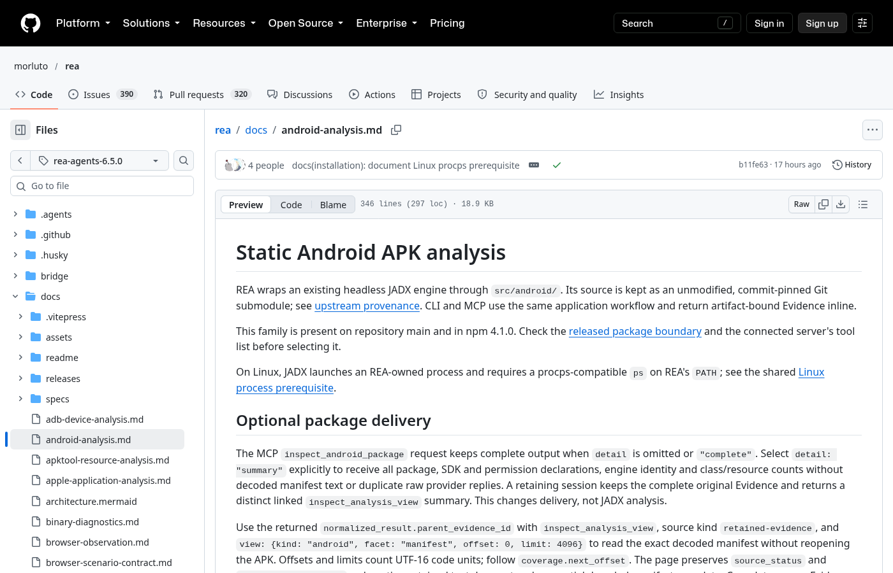

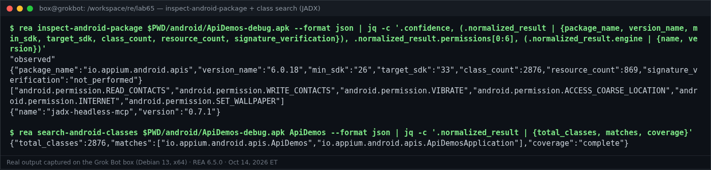

```text
$ rea inspect-android-package $PWD/android/ApiDemos-debug.apk --format json | jq -c '.confidence, (.normalized_result | {package_name, version_name, min_sdk, target_sdk, class_count, resource_count, signature_verification}), .normalized_result.permissions[0:6], (.normalized_result.engine | {name, version})'
"observed"
{"package_name":"io.appium.android.apis","version_name":"6.0.18","min_sdk":"26","target_sdk":"33","class_count":2876,"resource_count":869,"signature_verification":"not_performed"}
["android.permission.READ_CONTACTS","android.permission.WRITE_CONTACTS","android.permission.VIBRATE","android.permission.ACCESS_COARSE_LOCATION","android.permission.INTERNET","android.permission.SET_WALLPAPER"]
{"name":"jadx-headless-mcp","version":"0.7.1"}

$ rea search-android-classes $PWD/android/ApiDemos-debug.apk ApiDemos --format json | jq -c '.normalized_result | {total_classes, matches, coverage}'
{"total_classes":2876,"matches":["io.appium.android.apis.ApiDemos","io.appium.android.apis.ApiDemosApplication"],"coverage":"complete"}
```

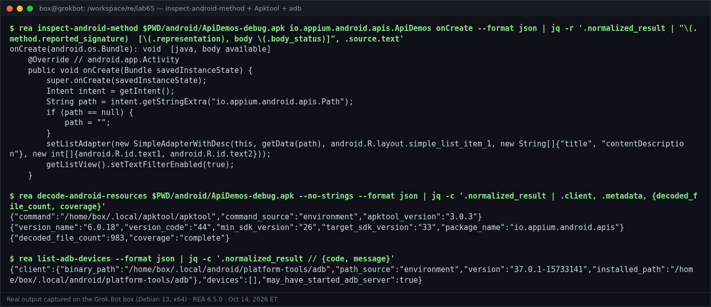

```text
$ rea inspect-android-method $PWD/android/ApiDemos-debug.apk io.appium.android.apis.ApiDemos onCreate --format json | jq -r '.normalized_result | "\(.method.reported_signature)  [\(.representation), body \(.body_status)]", .source.text'
onCreate(android.os.Bundle): void  [java, body available]
    @Override // android.app.Activity
    public void onCreate(Bundle savedInstanceState) {
        super.onCreate(savedInstanceState);
        Intent intent = getIntent();
        String path = intent.getStringExtra("io.appium.android.apis.Path");
        if (path == null) {
            path = "";
        }
        setListAdapter(new SimpleAdapterWithDesc(this, getData(path), android.R.layout.simple_list_item_1, new String[]{"title", "contentDescription"}, new int[]{android.R.id.text1, android.R.id.text2}));
        getListView().setTextFilterEnabled(true);
    }

$ rea decode-android-resources $PWD/android/ApiDemos-debug.apk --no-strings --format json | jq -c '.normalized_result | .client, .metadata, {decoded_file_count, coverage}'
{"command":"/home/box/.local/apktool/apktool","command_source":"environment","apktool_version":"3.0.3"}
{"version_name":"6.0.18","version_code":"44","min_sdk_version":"26","target_sdk_version":"33","package_name":"io.appium.android.apis"}
{"decoded_file_count":983,"coverage":"complete"}

$ rea list-adb-devices --format json | jq -c '.normalized_result // {code, message}'
{"client":{"binary_path":"/home/box/.local/android/platform-tools/adb","path_source":"environment","version":"37.0.1-15733141","installed_path":"/home/box/.local/android/platform-tools/adb"},"devices":[],"may_have_started_adb_server":true}
```

Notes:
- `signature_verification: "not_performed"`: REA reports the APK's declarations; it doesn't vouch for the signature.
- `list-adb-devices` says `may_have_started_adb_server: true`. It had, so I ran `adb kill-server` afterwards.
- The device-changing tools (`install_adb_package`, `push_adb_file`, `start_adb_app`) were **not** run. There's no device, and they're side-effecting by design.

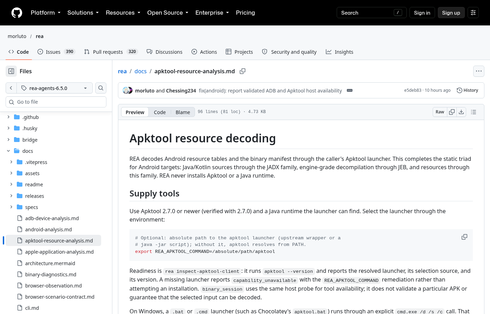

## 3. Firmware (replaces §10.5)

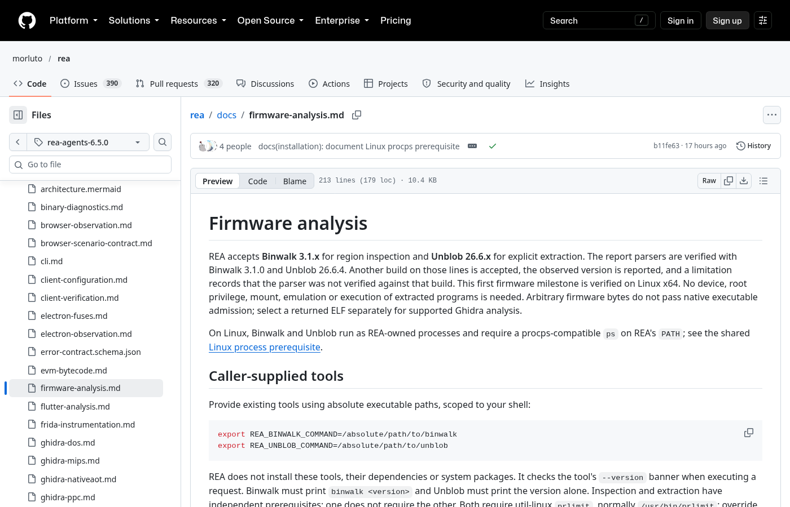

My image `lab65-fw.bin` (188,416 bytes) is a 512-byte custom `LAB65FW` header, then an xz-compressed squashfs root filesystem (a Rust daemon `bin/hellod`, `etc/device.conf`, `www/index.html`), then a gzip'd tar with `wifi.conf`, padded to 4 KiB.

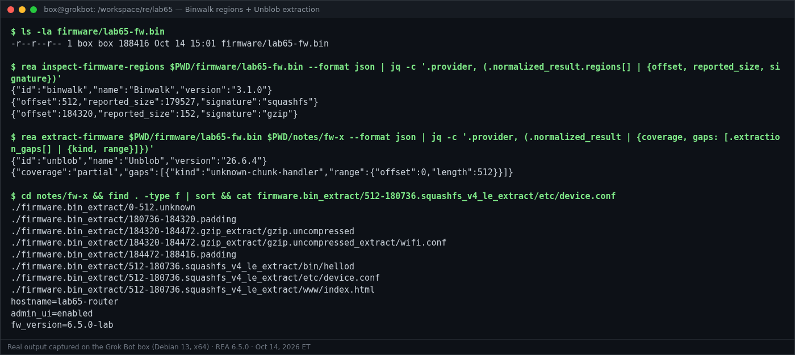

```text
$ ls -la firmware/lab65-fw.bin
-r--r--r-- 1 box box 188416 Oct 14 15:01 firmware/lab65-fw.bin

$ rea inspect-firmware-regions $PWD/firmware/lab65-fw.bin --format json | jq -c '.provider, (.normalized_result.regions[] | {offset, reported_size, signature})'
{"id":"binwalk","name":"Binwalk","version":"3.1.0"}
{"offset":512,"reported_size":179527,"signature":"squashfs"}
{"offset":184320,"reported_size":152,"signature":"gzip"}

$ rea extract-firmware $PWD/firmware/lab65-fw.bin $PWD/notes/fw-x --format json | jq -c '.provider, (.normalized_result | {coverage, gaps: [.extraction_gaps[] | {kind, range}]})'
{"id":"unblob","name":"Unblob","version":"26.6.4"}
{"coverage":"partial","gaps":[{"kind":"unknown-chunk-handler","range":{"offset":0,"length":512}}]}

$ cd notes/fw-x && find . -type f | sort && cat firmware.bin_extract/512-180736.squashfs_v4_le_extract/etc/device.conf
./firmware.bin_extract/0-512.unknown
./firmware.bin_extract/180736-184320.padding
./firmware.bin_extract/184320-184472.gzip_extract/gzip.uncompressed
./firmware.bin_extract/184320-184472.gzip_extract/gzip.uncompressed_extract/wifi.conf
./firmware.bin_extract/184472-188416.padding
./firmware.bin_extract/512-180736.squashfs_v4_le_extract/bin/hellod
./firmware.bin_extract/512-180736.squashfs_v4_le_extract/etc/device.conf
./firmware.bin_extract/512-180736.squashfs_v4_le_extract/www/index.html
hostname=lab65-router
admin_ui=enabled
fw_version=6.5.0-lab
```

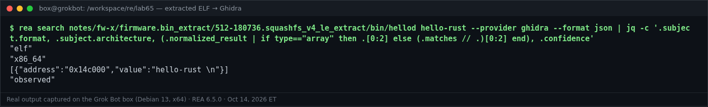

```text
$ rea search notes/fw-x/firmware.bin_extract/512-180736.squashfs_v4_le_extract/bin/hellod hello-rust --provider ghidra --format json | jq -c '.subject.format, .subject.architecture, (.normalized_result | if type=="array" then .[0:2] else (.matches // .)[0:2] end), .confidence'
"elf"
"x86_64"
[{"address":"0x14c000","value":"hello-rust \n"}]
"observed"
```

The one remaining gap (`unknown-chunk-handler`, bytes 0–512) is my custom header, which is correct. On the first run, before sasquatch was installed, Unblob reported `missing-extractor-dependency: sasquatch` for `squashfs_v4_le` and left the rootfs packed. REA surfaced that as an explicit gap instead of a silent "done".

## 4. .NET (replaces §10.7)

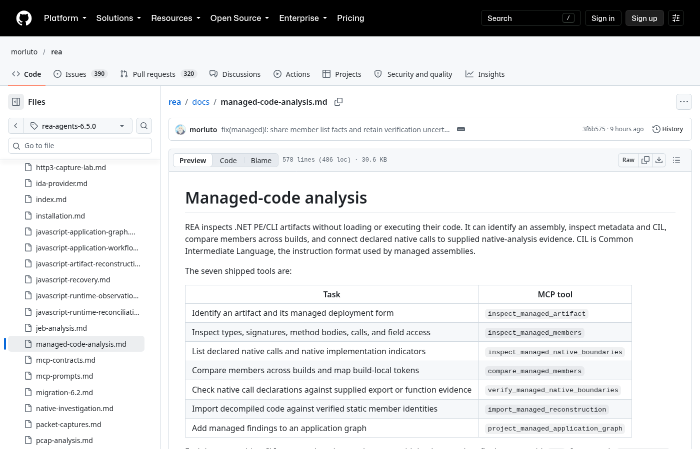

My assembly `PromoLab.dll` (.NET 8) is a harmless promo-code *format* checker with one P/Invoke:

```csharp
public sealed class PromoCode
{
    private const string Banner = "PromoLab code formatter v1";
    public static bool IsWellFormed(string code) => code.Length == 8 && code.StartsWith("LAB-") && Checksum(code) % 7 == 3;
    internal static int Checksum(string s) { int acc = 0; foreach (char c in s) acc = acc * 31 + c; return Math.Abs(acc); }
    public string Describe() => Banner;
}
public static class Native { [DllImport("libc", EntryPoint = "getpid")] public static extern int GetPid(); }
```

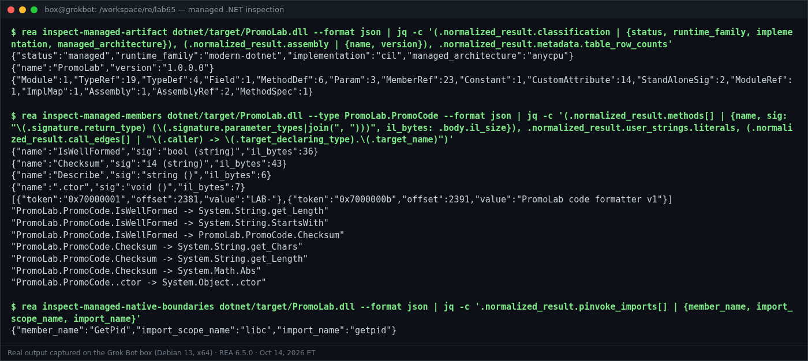

```text
$ rea inspect-managed-artifact dotnet/target/PromoLab.dll --format json | jq -c '(.normalized_result.classification | {status, runtime_family, implementation, managed_architecture}), (.normalized_result.assembly | {name, version}), .normalized_result.metadata.table_row_counts'
{"status":"managed","runtime_family":"modern-dotnet","implementation":"cil","managed_architecture":"anycpu"}
{"name":"PromoLab","version":"1.0.0.0"}
{"Module":1,"TypeRef":19,"TypeDef":4,"Field":1,"MethodDef":6,"Param":3,"MemberRef":23,"Constant":1,"CustomAttribute":14,"StandAloneSig":2,"ModuleRef":1,"ImplMap":1,"Assembly":1,"AssemblyRef":2,"MethodSpec":1}

$ rea inspect-managed-members dotnet/target/PromoLab.dll --type PromoLab.PromoCode --format json | jq -c '(.normalized_result.methods[] | {name, sig: "\(.signature.return_type) (\(.signature.parameter_types|join(", ")))", il_bytes: .body.il_size}), .normalized_result.user_strings.literals, (.normalized_result.call_edges[] | "\(.caller) -> \(.target_declaring_type).\(.target_name)")'
{"name":"IsWellFormed","sig":"bool (string)","il_bytes":36}
{"name":"Checksum","sig":"i4 (string)","il_bytes":43}
{"name":"Describe","sig":"string ()","il_bytes":6}
{"name":".ctor","sig":"void ()","il_bytes":7}
[{"token":"0x70000001","offset":2381,"value":"LAB-"},{"token":"0x7000000b","offset":2391,"value":"PromoLab code formatter v1"}]
"PromoLab.PromoCode.IsWellFormed -> System.String.get_Length"
"PromoLab.PromoCode.IsWellFormed -> System.String.StartsWith"
"PromoLab.PromoCode.IsWellFormed -> PromoLab.PromoCode.Checksum"
"PromoLab.PromoCode.Checksum -> System.String.get_Chars"
"PromoLab.PromoCode.Checksum -> System.String.get_Length"
"PromoLab.PromoCode.Checksum -> System.Math.Abs"
"PromoLab.PromoCode..ctor -> System.Object..ctor"

$ rea inspect-managed-native-boundaries dotnet/target/PromoLab.dll --format json | jq -c '.normalized_result.pinvoke_imports[] | {member_name, import_scope_name, import_name}'
{"member_name":"GetPid","import_scope_name":"libc","import_name":"getpid"}
```

REA never loads or runs the assembly. 6.5.0 adds the decoded `ldstr` literals and a declaring type on every call target, and both show up here.

## 5. rea doctor afterwards

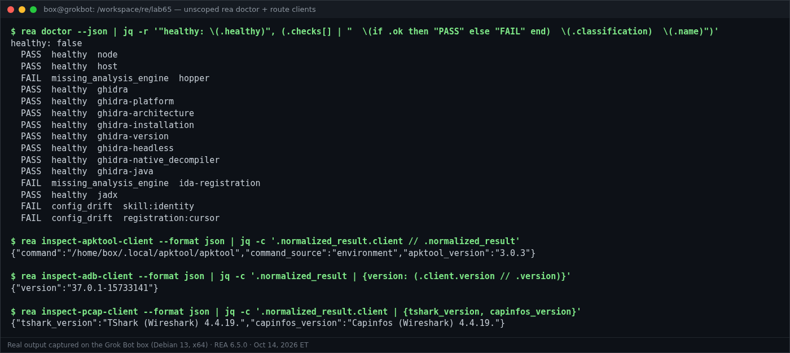

```text
$ rea doctor --json | jq -r '"healthy: \(.healthy)", (.checks[] | "  \(if .ok then "PASS" else "FAIL" end)  \(.classification)  \(.name)")'
healthy: false
  PASS  healthy  node
  PASS  healthy  host
  FAIL  missing_analysis_engine  hopper
  PASS  healthy  ghidra
  PASS  healthy  ghidra-platform
  PASS  healthy  ghidra-architecture
  PASS  healthy  ghidra-installation
  PASS  healthy  ghidra-version
  PASS  healthy  ghidra-headless
  PASS  healthy  ghidra-native_decompiler
  PASS  healthy  ghidra-java
  FAIL  missing_analysis_engine  ida-registration
  PASS  healthy  jadx
  FAIL  config_drift  skill:identity
  FAIL  config_drift  registration:cursor

$ rea inspect-apktool-client --format json | jq -c '.normalized_result.client // .normalized_result'
{"command":"/home/box/.local/apktool/apktool","command_source":"environment","apktool_version":"3.0.3"}

$ rea inspect-adb-client --format json | jq -c '.normalized_result | {version: (.client.version // .version)}'
{"version":"37.0.1-15733141"}

$ rea inspect-pcap-client --format json | jq -c '.normalized_result.client | {tshark_version, capinfos_version}'
{"tshark_version":"TShark (Wireshark) 4.4.19.","capinfos_version":"Capinfos (Wireshark) 4.4.19."}
```

| Check | Result | Why |
|---|---|---|
| node, host | PASS | Node 24.21.0; Debian 13 is now a supported host |
| ghidra (+7 sub-checks) | PASS | Ghidra 12.1.4, JDK 21.0.12.1 |
| jadx | PASS | `REA_JADX_MCP_JAR` → jadx-headless-mcp 0.7.1 |
| hopper | FAIL | Not installed (Hopper is the macOS default) |
| ida-registration | FAIL | No IDA MCP configured |
| skill:identity, registration:cursor | FAIL (config drift) | Doctor suggests `rea setup`; I didn't run it because it edits client configs |

Doctor has no Binwalk, Unblob, Apktool, adb or TShark check. Apktool, adb and TShark have their own `inspect-*-client` commands (shown above). Binwalk and Unblob are verified by running the route (§3).

## Links

- Android: <https://github.com/morluto/rea/blob/rea-agents-6.5.0/docs/android-analysis.md>
- Apktool resources: <https://github.com/morluto/rea/blob/rea-agents-6.5.0/docs/apktool-resource-analysis.md>
- Firmware: <https://github.com/morluto/rea/blob/rea-agents-6.5.0/docs/firmware-analysis.md>
- Managed / .NET: <https://github.com/morluto/rea/blob/rea-agents-6.5.0/docs/managed-code-analysis.md>
- Testing / recorded scope: <https://github.com/morluto/rea/blob/rea-agents-6.5.0/docs/testing.md>
- sasquatch: <https://github.com/onekey-sec/sasquatch/releases>
- Appium ApiDemos: <https://github.com/appium/android-apidemos>
